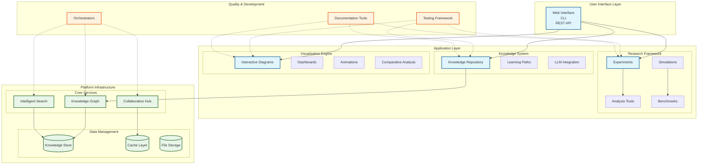
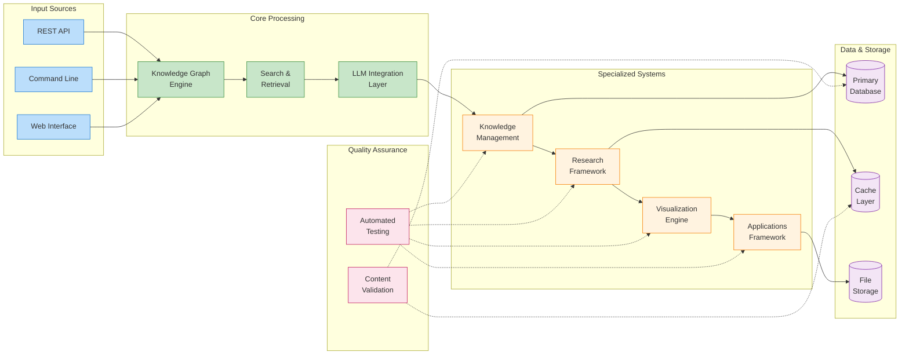
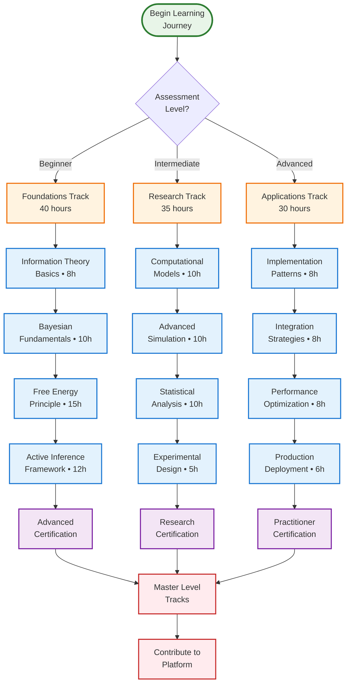
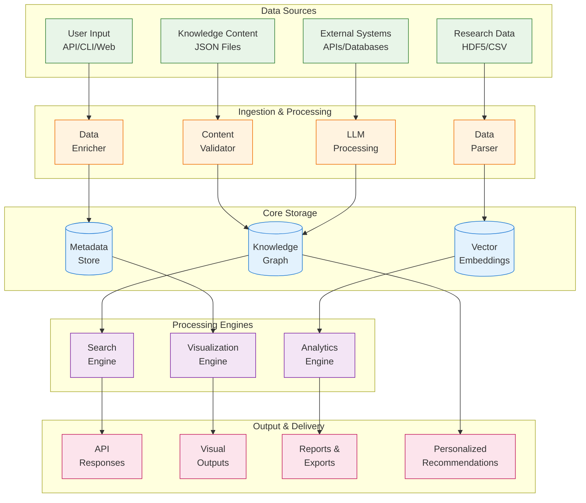

# Active Inference Knowledge Environment

<p align="center">
  <a href="https://github.com/docxology/active_inference/actions/workflows/ci.yml"></a>
  <a href="LICENSE"></a>
  
</p>

**"Active Inference for, with, by Generative AI"**

A comprehensive integrated platform for Active Inference & Free Energy Principle education, research, visualization, and application development. This repository provides a structured, accessible knowledge environment that bridges theoretical foundations with practical applications, built through collaborative intelligence among humans and AI.

## Current Status

*As of 2026-08-31, verified by the agent-ergonomics pass; the measured evidence
was retired as point-in-time scratch and remains available in git history. Open
work lives in [TODO.md](TODO.md) (canonical backlog); do not duplicate it here.*

- **This README below the fold is an aspirational catalog, not a status
  report.** Some directories it describes do not exist on disk (notably
  `visualization/` at repo root and several `tools/` subdirectories). Verify
  presence with `ls <dir>` before relying on any component.
- **Verification:** tests run via `.venv/bin/python -m pytest tests/` (pytest
  8.4.2 installed) or `make test`. Warning: on an external-drive checkout,
  `import pytest` alone takes ~47s and full collection can exceed 5 minutes —
  do not assume a hang. The `venv/` directory is a dangling symlink to a
  miniforge interpreter that no longer exists; use `.venv/`.
- **Executable status:** run `python3 tools/repo_status.py` for current facts
  (branch, sync state, dirty count, component presence) instead of trusting any
  prose table. Add `--tests` for a pytest collection count (slow on external
  drives).
- **Documentation debt (updated 2026-08-31, Round 2):** the 91 broken links
  measured in Round 1 were repaired repo-wide (157 files; 0 broken links remain
  across all 332 tracked .md files, verified by re-running the checker).

---

## 🎯 Mission & Vision

The Active Inference Knowledge Environment is the most comprehensive, accessible, and integrated platform for understanding and applying Active Inference principles. We build understanding through collaborative intelligence, combining human expertise with AI capabilities to create an unprecedented resource for learning, research, and application development.

## 🏗️ Architecture Overview

### Core Platform Components

#### 🧠 Knowledge Repository (`knowledge/`, `src/active_inference/knowledge/`)
**Educational Content & Learning Systems**
- **Structured Learning Paths**: Progressive curriculum from beginner to expert levels
- **Interactive Tutorials**: Hands-on examples with immediate feedback
- **Research Papers**: Annotated collection with implementation notes
- **Mathematical Foundations**: Rigorous derivations with computational examples
- **Domain Applications**: Specialized content for neuroscience, AI, psychology, robotics

📖 **[Knowledge Documentation](knowledge/README.md)** | 🤖 **[Knowledge AGENTS.md](knowledge/AGENTS.md)**

#### 🔬 Research Tools (`research/`, `src/active_inference/research/`)
**Scientific Research & Experimentation**
- **Experiment Framework**: Reproducible research pipelines
- **Simulation Engine**: Multi-scale modeling capabilities
- **Analysis Tools**: Statistical and information-theoretic methods
- **Benchmarking Suite**: Standardized evaluation frameworks
- **Validation Methods**: Rigorous scientific validation

🔬 **[Research Documentation](research/README.md)** | 🤖 **[Research AGENTS.md](research/AGENTS.md)**

#### 👁️ Visualization System (`visualization/`, `src/active_inference/visualization/`)
**Interactive Exploration & Understanding**
- **Interactive Diagrams**: Dynamic concept visualizations
- **Simulation Dashboards**: Real-time model exploration
- **Comparative Analysis**: Side-by-side model comparisons
- **Educational Animations**: Step-by-step process demonstrations
- **3D Visualizations**: Immersive 3D model exploration

👁️ **Visualization Documentation `research/visualization/README.md`** | 🤖 **Visualization AGENTS.md `research/visualization/AGENTS.md`**

#### 🛠️ Applications Framework (`applications/`, `src/active_inference/applications/`)
**Practical Implementation & Deployment**
- **Template Library**: Ready-to-use implementation patterns
- **Case Studies**: Real-world application examples
- **Integration Tools**: APIs and connectors for external systems
- **Best Practices**: Architectural guidelines and patterns
- **Domain Templates**: Specialized templates for different fields

🛠️ **[Applications Documentation](applications/README.md)** | 🤖 **[Applications AGENTS.md](applications/AGENTS.md)**

#### 🖥️ Platform Infrastructure (`platform/`, `src/active_inference/platform/`)
**Web Services & Backend Systems**
- **REST API Server**: Comprehensive platform APIs
- **Knowledge Graph**: Semantic knowledge representation
- **Search Engine**: Intelligent search and retrieval
- **Collaboration Tools**: Multi-user collaboration features
- **Deployment System**: Production deployment and scaling

🖥️ **[Platform Documentation](platform/README.md)** | 🤖 **[Platform AGENTS.md](platform/AGENTS.md)**

## 🏛️ Architecture Diagrams

### System Architecture Overview


### Component Relationship Flow


### Learning Pathways Flow


### Data Flow Architecture


#### 🧪 Quality Assurance (`tests/`)
**Testing & Validation**
- **Unit Tests**: Individual component functionality
- **Integration Tests**: Component interaction validation
- **Knowledge Tests**: Content accuracy and completeness
- **Performance Tests**: Scalability and efficiency validation
- **Security Tests**: Security and vulnerability testing

🧪 **[Testing Documentation](tests/README.md)** | 🤖 **[Testing AGENTS.md](tests/AGENTS.md)**

#### 🛠️ Development Tools (`tools/`, `src/active_inference/tools/`)
**Development & Orchestration**
- **Orchestrators**: Thin orchestration components
- **Utilities**: Helper functions and development tools
- **Testing Frameworks**: Test development and execution tools
- **Documentation Generators**: Automated documentation generation
- **Build Systems**: Development and deployment automation

🛠️ **[Tools Documentation](tools/README.md)** | 🤖 **[Tools AGENTS.md](tools/AGENTS.md)**

## 📚 Complete Project Structure

```
active_inference/
├── knowledge/        # Educational content & learning paths
│   ├── foundations/  │   ├── mathematics/  │   ├── implementations/
│   ├── applications/ │   ├── metadata/     │   └── learning_paths.json
├── research/         # Research tools & scientific methods
│   ├── experiments/  │   ├── simulations/  │   ├── analysis/
│   ├── benchmarks/   │   ├── data_management/ │   ├── model_development/
│   ├── project_planning/ │   ├── reporting/ │   ├── tools/
│   └── visualization/
├── applications/     # Practical applications & templates
│   ├── templates/    │   ├── case_studies/ │   ├── integrations/
│   ├── best_practices/ │   └── domains/    # per-domain content incl. README+AGENTS
├── platform/         # Platform infrastructure & services
│   ├── knowledge_graph/ │   ├── search/    │   ├── collaboration/
│   └── deployment/
├── src/              # Python package (active_inference.*) mirroring the above
│   └── active_inference/
│       ├── knowledge/    │   ├── research/    │   ├── visualization/
│       ├── applications/ │   ├── platform/    │   ├── tools/
│       └── llm/
├── tools/            # Development & audit tooling (tools/documentation/, tools/templates/, tools/prompts/)
├── tests/            # unit/ integration/ knowledge/ performance/ security/ utilities/ fixtures/
└── docs/             # Documentation hub (Sphinx), incl. manuscript/ and DOCUMENTATION_INDEX.md

NOTE (2026-08-31): this tree reflects directories that exist on disk (verified
by `ls`). Earlier versions of this README listed a root-level `visualization/`
and several `tools/` subdirectories that do not exist — the visualization
implementation lives in `src/active_inference/visualization/` and its content
in `research/visualization/`.
```

## 🔗 Component Navigation & Cross-References

### 📖 Knowledge System Navigation
| Component | Overview | Implementation | Applications | Agent Guide |
|-----------|----------|----------------|--------------|-------------|
| **[Foundations](knowledge/foundations/)** | [Overview](knowledge/foundations/README.md) | [Source](src/active_inference/knowledge/foundations.py) | [Examples](knowledge/foundations/) | [Guidelines](knowledge/foundations/AGENTS.md) |
| **[Mathematics](knowledge/mathematics/)** | [Overview](knowledge/mathematics/README.md) | [Source](src/active_inference/knowledge/mathematics.py) | [Examples](knowledge/mathematics/) | [Guidelines](knowledge/mathematics/AGENTS.md) |
| **[Implementations](knowledge/implementations/)** | [Overview](knowledge/implementations/README.md) | [Source](src/active_inference/knowledge/implementations.py) | [Examples](knowledge/implementations/) | [Guidelines](knowledge/implementations/AGENTS.md) |
| **[Applications](knowledge/applications/)** | [Overview](knowledge/applications/README.md) | [Source](src/active_inference/knowledge/applications.py) | [Examples](knowledge/applications/) | [Guidelines](knowledge/applications/AGENTS.md) |

### 🔬 Research Framework Navigation
| Component | Overview | Implementation | Tools | Agent Guide |
|-----------|----------|----------------|-------|-------------|
| **[Experiments](research/experiments/)** | [Overview](research/experiments/README.md) | [Source](src/active_inference/research/experiments.py) | [Tools](research/experiments/) | [Guidelines](research/experiments/AGENTS.md) |
| **[Simulations](research/simulations/)** | [Overview](research/simulations/README.md) | [Source](src/active_inference/research/simulations.py) | [Tools](research/simulations/) | [Guidelines](research/simulations/AGENTS.md) |
| **[Analysis](research/analysis/)** | [Overview](research/analysis/README.md) | [Source](src/active_inference/research/analysis.py) | [Tools](research/analysis/) | [Guidelines](research/analysis/AGENTS.md) |
| **[Benchmarks](research/benchmarks/)** | [Overview](research/benchmarks/README.md) | [Source](src/active_inference/research/benchmarks.py) | [Tools](research/benchmarks/) | [Guidelines](research/benchmarks/AGENTS.md) |

### 🖥️ Platform Infrastructure Navigation
| Component | Overview | Implementation | Services | Agent Guide |
|-----------|----------|----------------|----------|-------------|
| **[Knowledge Graph](platform/knowledge_graph/)** | [Overview](platform/knowledge_graph/README.md) | [Source](src/active_inference/platform/knowledge_graph.py) | [API](platform/knowledge_graph/) | [Guidelines](platform/knowledge_graph/AGENTS.md) |
| **[Search](platform/search/)** | [Overview](platform/search/README.md) | [Source](src/active_inference/platform/search.py) | [API](platform/search/) | [Guidelines](platform/search/AGENTS.md) |
| **[Collaboration](platform/collaboration/)** | [Overview](platform/collaboration/README.md) | [Source](src/active_inference/platform/collaboration.py) | [API](platform/collaboration/) | [Guidelines](platform/collaboration/AGENTS.md) |
| **[Deployment](platform/deployment/)** | [Overview](platform/deployment/README.md) | [Source](src/active_inference/platform/deployment.py) | [Tools](platform/deployment/) | [Guidelines](platform/deployment/AGENTS.md) |

### 🛠️ Applications Framework Navigation
| Component | Overview | Implementation | Templates | Agent Guide |
|-----------|----------|----------------|-----------|-------------|
| **[Templates](applications/templates/)** | [Overview](applications/templates/README.md) | [Source](src/active_inference/applications/templates.py) | [Library](applications/templates/) | [Guidelines](applications/templates/AGENTS.md) |
| **[Case Studies](applications/case_studies/)** | [Overview](applications/case_studies/README.md) | [Source](src/active_inference/applications/case_studies.py) | [Examples](applications/case_studies/) | [Guidelines](applications/case_studies/AGENTS.md) |
| **[Integrations](applications/integrations/)** | [Overview](applications/integrations/README.md) | [Source](src/active_inference/applications/integrations.py) | [APIs](applications/integrations/) | [Guidelines](applications/integrations/AGENTS.md) |
| **[Best Practices](applications/best_practices/)** | [Overview](applications/best_practices/README.md) | [Source](src/active_inference/applications/best_practices.py) | [Guidelines](applications/best_practices/) | [Guidelines](applications/best_practices/AGENTS.md) |

### 🧪 Testing Framework Navigation
| Component | Overview | Implementation | Test Cases | Agent Guide |
|-----------|----------|----------------|------------|-------------|
| **[Unit Tests](tests/unit/)** | [Overview](tests/unit/README.md) | [Source](tests/unit/) | [Tests](tests/unit/) | [Guidelines](tests/unit/AGENTS.md) |
| **[Integration Tests](tests/integration/)** | [Overview](tests/integration/README.md) | [Source](tests/integration/) | [Tests](tests/integration/) | [Guidelines](tests/integration/AGENTS.md) |
| **[Knowledge Tests](tests/knowledge/)** | [Overview](tests/knowledge/README.md) | [Source](tests/knowledge/) | [Tests](tests/knowledge/) | [Guidelines](tests/knowledge/AGENTS.md) |
| **[Performance Tests](tests/performance/)** | [Overview](tests/performance/README.md) | [Source](tests/performance/) | [Tests](tests/performance/) | [Guidelines](tests/performance/AGENTS.md) |

### 📚 Documentation System Navigation
| Component | Overview | Implementation | Content | Agent Guide |
|-----------|----------|----------------|---------|-------------|
| **[API Docs](docs/api/)** | [Overview](docs/api/README.md) | [Source](docs/api/) | [References](docs/api/) | [Guidelines](docs/api/AGENTS.md) |
| **[Knowledge Docs](docs/knowledge/)** | [Overview](docs/knowledge/README.md) | [Source](docs/knowledge/) | [Guides](docs/knowledge/) | [Guidelines](docs/knowledge/AGENTS.md) |
| **[Platform Docs](docs/platform/)** | [Overview](docs/platform/README.md) | [Source](docs/platform/) | [Guides](docs/platform/) | [Guidelines](docs/platform/AGENTS.md) |
| **[Research Docs](docs/research/)** | [Overview](docs/research/README.md) | [Source](docs/research/) | [Guides](docs/research/) | [Guidelines](docs/research/AGENTS.md) |

## 📋 Development Standards & Guidelines

This project follows comprehensive development standards documented in **[.cursorrules](.cursorrules)** - the complete guide for AI agents and contributors. All development must adhere to these standards:

### Key Standards
- **🧪 Test-Driven Development (TDD)**: All code must follow TDD with comprehensive test coverage (>95% for core components)
- **📚 Documentation-First**: Complete documentation before implementation
- **🎯 Type Safety**: 100% type annotations with no `Any` types without justification
- **📖 Structured Content**: All knowledge content follows strict JSON schema
- **🔄 Modular Architecture**: Clean interfaces and dependency management
- **🚀 Performance Optimization**: Efficient algorithms and data structures

### Quality Gates
- **Test Coverage**: >95% for core components, >80% overall
- **Code Quality**: PEP 8 compliance with automated formatting
- **Security**: Industry-standard security practices
- **Performance**: Sub-second response times for user interactions
- **Documentation**: 100% API and interface documentation coverage

**📖 [Complete Development Standards](.cursorrules)** - Required reading for all contributors.

## 🚀 Getting Started

### Prerequisites
- **Python 3.9+** - Core functionality and scientific computing
- **Node.js 18+** - Visualization components (optional)
- **Docker** - Containerized deployments (optional)
- **Git** - Version control and collaboration

### Quick Start
```bash
# Clone the repository
git clone https://github.com/docxology/active_inference.git
cd active_inference

# Set up development environment
make setup

# Run comprehensive tests
make test

# Start the knowledge platform
make serve

# Explore learning paths
ai-knowledge learn foundations

# Run research experiments
ai-research experiments run

# Generate documentation
make docs
```

### Development Setup
```bash
# Create virtual environment (uv-managed; this repo's working env is .venv/)
uv venv
source .venv/bin/activate  # Linux/Mac
# or .venv\Scripts\activate  # Windows

# Install all dependencies
uv sync --extra test

# Set up pre-commit hooks
pre-commit install

# Run tests
make test

# Generate documentation
make docs

# Start development server
python platform/serve.py
```

> **Environment note (verified 2026-08-31):** the previously documented
> `python3 -m venv venv` path leaves a `venv/` whose interpreter symlinks to a
> system location that may not exist (the committed `venv/` in this repo was
> exactly that: a dangling symlink). Use `uv venv` / `.venv/`. Also note that
> on external-drive checkouts, `import pytest` alone can take ~47s and full
> test collection exceeds 5 minutes — a slow start is not a hang.

## 🎓 Learning Pathways

### Foundation Track (40 hours)
**For beginners and those new to Active Inference**
1. **Information Theory Basics** (8h) - Entropy, KL divergence, mutual information
2. **Bayesian Fundamentals** (10h) - Bayesian probability and inference
3. **Free Energy Principle** (15h) - Theoretical foundations and derivations
4. **Active Inference Framework** (12h) - Complete Active Inference implementation

### Research Track (35 hours)
**For researchers and advanced students**
1. **Computational Models** (10h) - Implementation strategies and algorithms
2. **Advanced Simulation** (10h) - Multi-scale modeling and neural simulation
3. **Statistical Analysis** (10h) - Information-theoretic evaluation methods
4. **Experimental Design** (5h) - Research methodology and validation

### Application Track (30 hours)
**For developers and practitioners**
1. **Implementation Patterns** (8h) - Common architectural patterns
2. **Integration Strategies** (8h) - Connecting with external systems
3. **Performance Optimization** (8h) - Scaling and efficiency optimization
4. **Production Deployment** (6h) - Real-world deployment considerations

## 🔧 Platform Features

### Web Interface
- **Learning Dashboard**: Personalized learning recommendations and progress tracking
- **Research Workbench**: Experiment design, execution, and analysis tools
- **Visualization Studio**: Interactive diagram builder and model exploration
- **Collaboration Hub**: Multi-user content creation and discussion
- **Knowledge Browser**: Semantic search and concept navigation

### Command Line Interface
```bash
# Learning commands
ai-knowledge learn foundations          # Start foundations track
ai-knowledge search "free energy"       # Search knowledge base
ai-knowledge path show complete        # Display learning path
ai-knowledge export pdf foundations    # Export learning materials

# Research commands
ai-research experiments run             # Execute experiment suite
ai-research simulations benchmark       # Run simulation benchmarks
ai-research analyze results             # Analyze experimental results

# Platform commands
ai-platform serve                      # Start web platform
ai-platform status                     # Show system status
ai-platform backup                     # Create system backup
ai-platform update                     # Update platform components
```

### REST API
```bash
# Knowledge API
GET  /api/knowledge/search?q=entropy&limit=10
GET  /api/knowledge/nodes/fep_introduction
GET  /api/knowledge/paths/foundations_complete

# Research API
POST /api/research/experiments
GET  /api/research/simulations/{id}/results

# Platform API
GET  /api/platform/health
POST /api/platform/backup
```

## 📊 Quality Metrics & Standards

### Code Quality
- **Test Coverage**: >95% for core components
- **Documentation Coverage**: 100% API documentation
- **Code Style**: PEP 8 compliance with automated formatting
- **Type Safety**: Complete type annotations
- **Performance**: Optimized for research and educational use

### Content Quality
- **Educational Value**: Progressive disclosure and scaffolding
- **Technical Accuracy**: Peer-reviewed mathematical content
- **Completeness**: Comprehensive coverage of Active Inference
- **Accessibility**: Multiple learning styles and accessibility support
- **Currency**: Updated with latest research developments

### Platform Quality
- **Reliability**: 99.9% uptime with comprehensive monitoring
- **Scalability**: Horizontal scaling for growing user base
- **Security**: Industry-standard security practices
- **Performance**: Sub-second response times for all operations
- **Integration**: Seamless integration with scientific tools

## 🤝 Contributing

We welcome contributions from the global Active Inference community! This project thrives on collaborative intelligence between researchers, educators, developers, and AI assistants.

### 📋 Required Reading for Contributors
1. **[.cursorrules](.cursorrules)** - Complete development standards and agent guidelines (MANDATORY)
2. **[CONTRIBUTING.md](CONTRIBUTING.md)** - Detailed contribution processes and workflows
3. **[AGENTS.md](AGENTS.md)** - Master agent development guidelines
4. **Component Documentation** - README.md and AGENTS.md in relevant directories

### Contribution Types
- **📚 Knowledge Content**: Educational materials, tutorials, research papers
- **🔬 Research Tools**: New analysis methods, simulation engines, benchmarks
- **👁️ Visualizations**: Interactive diagrams, animations, dashboards
- **🛠️ Applications**: Templates, case studies, integration tools
- **🖥️ Platform**: Services, APIs, infrastructure improvements
- **📖 Documentation**: Guides, examples, translations

### Getting Started
1. **Read Guidelines**: [.cursorrules](.cursorrules) and [CONTRIBUTING.md](CONTRIBUTING.md) for detailed processes
2. **Choose Area**: Select component matching your expertise
3. **Follow Standards**: TDD, documentation, and quality requirements (see .cursorrules)
4. **Community Review**: Submit for peer review and validation
5. **Iterate**: Incorporate feedback and improve

## 📈 Impact & Recognition

### Educational Impact
- **Accessibility**: Lowering barriers to Active Inference understanding
- **Depth**: Comprehensive coverage from basics to advanced topics
- **Application**: Clear paths from theory to practical implementation
- **Community**: Building global Active Inference learning community

### Research Impact
- **Reproducibility**: Standardized research frameworks and tools
- **Collaboration**: Shared platforms for collaborative research
- **Innovation**: Accelerated discovery through integrated tools
- **Translation**: Faster transition from theory to application

### Technical Innovation
- **AI-Human Collaboration**: Novel collaborative development approach
- **Knowledge Integration**: Unified knowledge representation
- **Interactive Learning**: Next-generation educational technology
- **Research Automation**: Automated research workflows and analysis

## 🔗 Integration & Compatibility

### External Systems
- **Academic Platforms**: Integration with university LMS systems
- **Research Repositories**: Connection to arXiv, bioRxiv, etc.
- **Development Tools**: GitHub, GitLab, Jupyter integration
- **Communication**: Slack, Discord, forum integration

### Data Formats
- **Knowledge Formats**: JSON, Markdown, Jupyter, LaTeX
- **Research Data**: HDF5, CSV, JSON, specialized formats
- **Visualization**: SVG, PNG, HTML, interactive formats
- **Export Formats**: PDF, HTML, Markdown, JSON, XML

## 📚 Documentation Ecosystem

This project features comprehensive documentation at every level:

### Master Documentation
- **[Main README](README.md)**: Project overview and navigation (this file)
- **[AGENTS.md](AGENTS.md)**: Agent development guidelines and workflows
- **[CONTRIBUTING.md](CONTRIBUTING.md)**: Contribution processes and standards

### Component Documentation
Each major component has comprehensive documentation:
- **[Knowledge](knowledge/README.md)**: Educational content and learning systems
- **[Research](research/README.md)**: Scientific tools and methodologies
- **[Applications](applications/README.md)**: Implementation frameworks and patterns
- **[Platform](platform/README.md)**: Infrastructure and services
- **Visualization `research/visualization/README.md`**: Interactive exploration tools
- **[Tests](tests/README.md)**: Quality assurance and validation

### Technical Documentation
- **[API Reference](docs/api/README.md)**: Complete API documentation
- **[Development Guide](CONTRIBUTING.md)**: Contributing and development workflows
- **[Architecture Guide](docs/platform/README.md)**: System architecture and design
- **[Deployment Guide](platform/deployment/README.md)**: Production deployment

## 🎯 Success Metrics

### Quantitative Metrics
- **User Engagement**: Daily/monthly active learners and researchers
- **Content Growth**: Knowledge nodes and learning paths added
- **Research Output**: Experiments run and papers published using platform
- **System Performance**: Response times and uptime reliability

### Qualitative Metrics
- **Learning Outcomes**: User mastery of Active Inference concepts
- **Research Impact**: Citations and adoption in research community
- **Community Growth**: Contributors and active participants
- **Educational Quality**: Learner satisfaction and recommendation rates

### Innovation Metrics
- **AI-Human Collaboration**: Quality and quantity of collaborative content
- **Knowledge Integration**: Effectiveness of unified knowledge representation
- **Learning Technology**: Advancement of educational technology
- **Research Acceleration**: Speed of research discovery and validation

## 🌟 Key Innovations

### 1. **Unified Knowledge Graph**
Semantic relationships between all concepts with automatic prerequisite validation and intelligent recommendation systems.

### 2. **Progressive Disclosure**
Adaptive content delivery based on learner progress with multiple representation levels (intuitive → formal → implementation).

### 3. **Research-Teaching Integration**
Seamless transition from theory to practice with reproducible research workflows and interactive experimentation.

### 4. **Collaborative Intelligence**
Human-AI co-creation of educational content with community-driven knowledge expansion and collective intelligence amplification.

### 5. **Interactive Learning Environment**
Next-generation educational technology with real-time feedback, personalized learning paths, and immersive exploration tools.

## 📞 Support & Community

### Getting Help
- **📖 Documentation**: Comprehensive guides and tutorials
- **🔍 Search**: Intelligent search across all content
- **💬 Discussions**: Community discussions and Q&A
- **🐛 Issues**: Bug reports and feature requests
- **📧 Support**: Direct support for technical issues

### Community Engagement
- **🤝 Contributors**: Join our global contributor community
- **🎓 Educators**: Access educational resources and tools
- **🔬 Researchers**: Use research tools and collaborate
- **💻 Developers**: Build applications and integrations
- **📚 Students**: Learn Active Inference through structured paths

## 📄 License & Attribution

This project is licensed under the MIT License - see the [LICENSE](LICENSE) file for details.

### Acknowledgments
- **Karl Friston** and the Active Inference research community for theoretical foundations
- **Free Energy Principle** contributors for mathematical and conceptual framework
- **Open Source Community** for tools, inspiration, and collaborative spirit
- **AI Assistants** for collaborative content creation and development support

### Citation
If you use this platform in your research or teaching, please cite:

```
Active Inference Knowledge Environment. (2024).
"Active Inference for, with, by Generative AI".
https://github.com/docxology/active_inference
```

## 🔄 Version & Status

- **Version**: 0.2.0 (Active Development)
- **Status**: Beta Release
- **Last Updated**: October 2024
- **Development**: Continuous active development
- **Support**: Community-supported with active maintenance

---

**"Active Inference for, with, by Generative AI"** - Together, we're building the most comprehensive platform for understanding intelligence, cognition, and behavior through the lens of Active Inference and the Free Energy Principle.

**Built with**: ❤️ Human expertise, 🤖 AI assistance, 🧠 Deep learning, and the collective intelligence of the global Active Inference community. 

Starting on October 27, 2025
https://www.youtube.com/live/ZWF8wXxKXlI
CodeStream #004.1 ~ Active Inference for, with, by Generative AI (An Experiment)
https://github.com/docxology/active_inference

Cursor 2.0.14
"Free" use of code-supernova-1-million
???????

What might happen when starting "from scratch" with large language models?

For learning/documenting functionality, and building, and seeing what happens when we "do it live". 

Starting with initial prompt: 

Comprehensively plan for creating the most comprehensive integrated knowledge environment for Active Inference & Free Energy Principle education, research, visualization, and application. You have maximum agentic capacities for technical work. Start and proceed for considering all nested structures, documentation, tests, thin orchestrators, and including rigorous accessible structured educational knowledge repository.  
